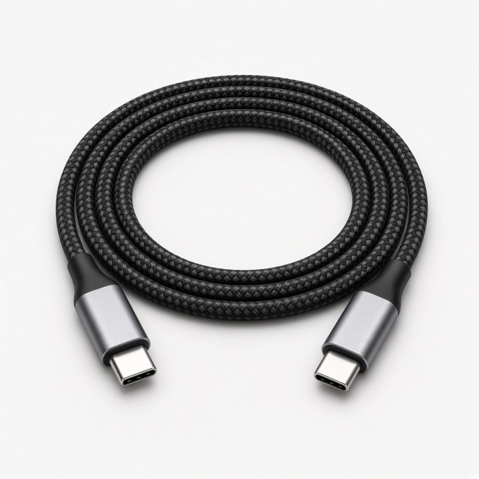

# Tanisha Telecom

Gadgets e-commerce: smartphones, laptops, smartwatches and accessories.

**Live site:** [tanishatelecom.com](https://tanishatelecom.com)

**Made by Tahsan Islam.** Copyright (c) Tahsan Islam.

Full stack e-commerce for Bangladesh: HTML/CSS/JS storefront, Laravel 13 API and admin panel, MySQL, and shurjoPay (bKash, Nagad, Rocket, cards) plus Cash on Delivery.

---

## Screenshots

### Homepage


### Storefront highlight


### Sample product


---

## Stack

| Layer | Tech |
|-------|------|
| Storefront | HTML, CSS, JavaScript (`public/*.html`, `public/assets/`) |
| Backend API | Laravel 13 REST API (`/api/...`) |
| Admin | Laravel Blade (`/admin`) |
| Database | MySQL |
| Payments | shurjoPay + Cash on Delivery |

---

## Features

### Storefront
- Home banner, sliders, product grid, categories
- Shop with search, category filter, price filter, sorting, pagination
- Product details, cart, wishlist
- Checkout with inside/outside Dhaka delivery charge
- Online payment (shurjoPay) or Cash on Delivery
- Order tracking and pay-again for failed payments
- Customer register / login / order history
- Contact form, About, Refund, Terms pages
- Mobile responsive layout

### Admin panel
- Dashboard: revenue, orders, 7-day sales chart, low stock, bestsellers
- Products: image upload, sale price, stock, featured, show/hide
- Categories, orders (status + payment status, printable invoice)
- shurjoPay verify button on orders
- Customers, contact messages, home sliders
- Page editor (About / Refund / Terms)
- Site settings: name, logo, banner, phone, email, address, Facebook, WhatsApp, delivery charges

---

## Quick start (local / XAMPP)

**Requirements:** PHP 8.3+, Composer, MySQL 5.7+ / MariaDB 10.3+

1. Create database `tanisha_telecom` (collation `utf8mb4_unicode_ci`).
2. Install and configure:

```bash
composer install
cp .env.example .env
# set DB_DATABASE=tanisha_telecom, DB_USERNAME=root, DB_PASSWORD=
php artisan key:generate
php artisan migrate --seed
php artisan serve
```

3. Open http://127.0.0.1:8000 (shop) and http://127.0.0.1:8000/admin (admin).

Or import `database/tanisha_telecom.sql` in phpMyAdmin instead of migrate --seed.

**Default admin:** `admin@gmail.com` / `admin000` (change after first login).

---

## Environment (important keys)

```env
APP_NAME="Tanisha Telecom"
APP_ENV=production
APP_DEBUG=false
APP_URL=https://tanishatelecom.com

DB_CONNECTION=mysql
DB_HOST=localhost
DB_DATABASE=tanisha_telecom
DB_USERNAME=your_db_user
DB_PASSWORD=your_db_password

SHURJOPAY_MODE=sandbox
SHURJOPAY_PREFIX=TTM
SHURJOPAY_SANDBOX_URL=https://sandbox.shurjopayment.com
SHURJOPAY_SANDBOX_USERNAME=sp_sandbox
SHURJOPAY_SANDBOX_PASSWORD="your_sandbox_password"
SHURJOPAY_LIVE_URL=https://engine.shurjopayment.com
SHURJOPAY_LIVE_USERNAME=your_live_api_username
SHURJOPAY_LIVE_PASSWORD="your_live_api_password"
```

Never commit real `.env` credentials.

---

## Deploy (cPanel / BDIX hosting)

1. Create MySQL database and user in cPanel; import `database/tanisha_telecom.sql` or run migrations.
2. Upload the project (run `composer install --no-dev --optimize-autoloader` first if the host has no Composer).
3. Point the domain document root to the `public/` folder (recommended).
4. Set production `.env` values above (`APP_URL=https://tanishatelecom.com`).
5. PHP 8.3+, extensions: `pdo_mysql`, `mbstring`, `openssl`, `fileinfo`, `gd`, `curl`.
6. Writable: `storage/`, `bootstrap/cache/`, `public/uploads/`.
7. Optional: `php artisan config:cache` and `php artisan route:cache`. After `.env` changes run `php artisan optimize:clear`.

**shurjoPay IPN URL:** `https://tanishatelecom.com/payment/shurjopay/ipn`

---

## Project layout

```
public/           Storefront HTML + assets
app/              Laravel app (API, Admin, payments)
routes/api.php    Storefront API
routes/web.php    Admin + payment return routes
database/         Migrations, seeders, SQL dump
resources/views/admin/  Admin Blade UI
```
---

## Author and copyright

Everything in this project was designed and developed by **Tahsan Islam**.

Copyright (c) 2026 **Tahsan Islam**. All rights reserved.
